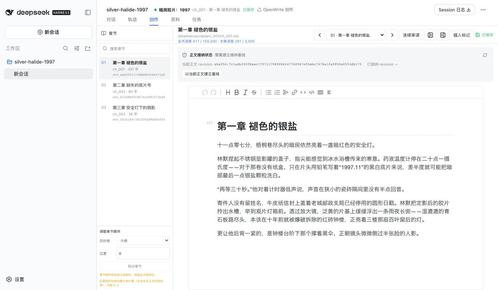
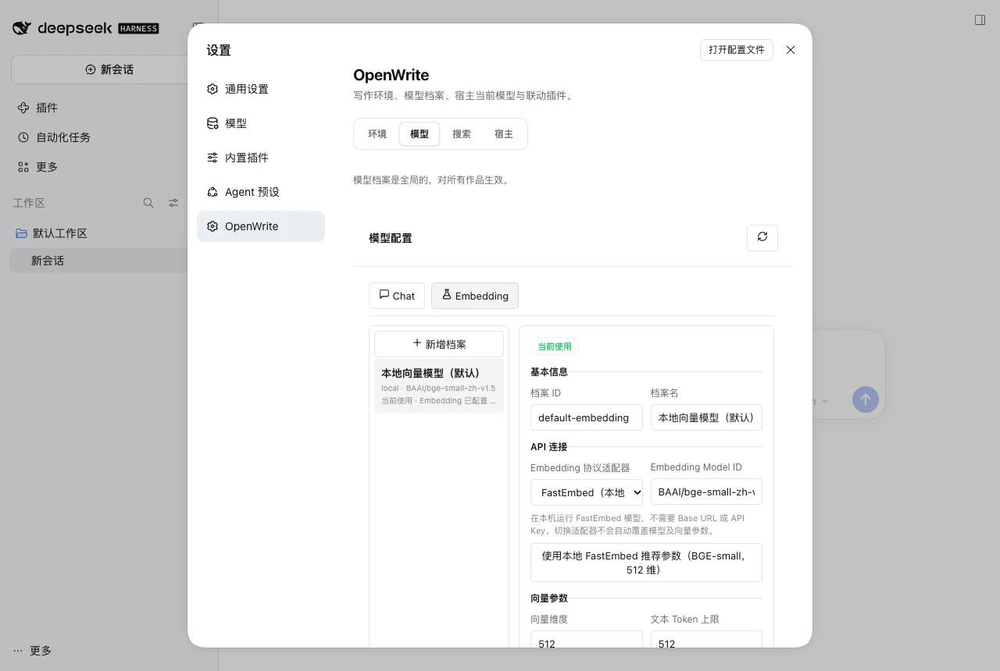

<div align="center">

<picture>
  <source media="(prefers-color-scheme: dark)" srcset="assets/logo-dark.svg" />
  <source media="(prefers-color-scheme: light)" srcset="assets/logo-light.svg" />
  
</picture>

# dsh-Openwrite

**让长篇创作，自成架构。**

DeepSeek Harness 原生小说规划、连续写章、审稿与本地资产工作室

<p>
  <a href="https://github.com/LiPu-jpg/Openwrite/releases/latest"></a>
  <a href="https://www.npmjs.com/package/dsh-openwrite"></a>
  <a href="package.json"></a>
  <a href="package.json">= 22.19" /></a>
  <a href="LICENSE"></a>
  <a href="https://dsh-plugin.org/plugins/lipu-jpg/openwrite"></a>
  <a href="https://github.com/LiPu-jpg/Openwrite/stargazers"></a>
</p>

<p>
  <a href="#快速安装">⚡ 快速安装</a> ·
  <a href="#工作台一览">🎨 工作台一览</a> ·
  <a href="#三步开始创作">🚀 开始使用</a> ·
  <a href="#核心能力">✨ 核心能力</a> ·
  <a href="#生态联动插件">🔗 联动生态</a> ·
  <a href="#升级回退与排错">🛠️ 升级与排错</a> ·
  <a href="#文档与工程架构">📚 文档</a> ·
  <a href="#language--english-guide">🌐 English</a>
</p>

</div>

<div align="center">

> 将大纲、人物设定、连续正文、六域审稿 DAG、多模型盲测与本地向量检索整合进 DeepSeek Harness 原生工作台。
>
> *Local-first novel studio for DeepSeek Harness: structured canon, context engine, Vditor prose workbench, multi-domain review DAG, model benchmarks, and EPUB export.*
>
> **全部作品目录、设定文件与 API 凭据均保存在你自己的本机目录；开箱内置本地 FastEmbed 向量检索，安装与健康检查零模型调用。**

</div>

---

## 目录

| 开始使用 | 创作与引擎 | 生态、维护与文档 |
| :--- | :--- | :--- |
| [工作台一览](#工作台一览)<br />[快速安装](#快速安装)<br />[三步开始创作](#三步开始创作) | [核心能力](#核心能力)<br />[配置模型与本地检索](#配置模型与本地检索)<br />[示例：从大纲开始一部新小说](#示例从大纲开始一部新小说) | [生态联动插件](#生态联动插件)<br />[升级、回退与排错](#升级回退与排错)<br />[文档与工程架构](#文档与工程架构) |

---

## 工作台一览

[DeepSeek Harness](https://github.com/deepseek-ai/deepseek-harness) 提供 Agent 会话与宿主界面，[OpenWrite Core](https://github.com/LiPu-jpg/Openwrite/tree/native-core) 提供长篇小说领域引擎。写作、审稿与设定维护全部在 dsh 里的三个原生页签完成——**创作**（正文、批注与版本锁）、**资料**（角色、世界观、分卷大纲、研究与图谱）、**任务**（模型档案、横向评测、导入与成书导出）。

<p align="center">
  <picture>
    <source media="(prefers-color-scheme: dark)" srcset="docs/assets/workflow-dark.svg" />
    <source media="(prefers-color-scheme: light)" srcset="docs/assets/workflow-light.svg" />
    
  </picture>
</p>

<p align="center">
  
  <br />
  <sub><b>「创作」工作台实拍</b> —— 左侧分卷章节导航与字数进度，右侧 Vditor 沉浸编辑、内容版本锁、选区标记与连续审读。</sub>
</p>

<p align="center">
  
  <br />
  <sub><b>「设置 → OpenWrite」配置中心</b> —— 安装即预置免密钥本地 <code>FastEmbed</code>（<code>BAAI/bge-small-zh-v1.5</code>，512 维）向量档案，支持一键测通与多模型分层路由。</sub>
</p>

---

## 快速安装

> **运行要求**：dsh 兼容宿主（见下方列表） · Node.js ≥ 22.19 · macOS arm64/x64、Linux x64、Windows x64。  
> 首次启动写入环境会自动下载固定版本的 `uv`、Python 3.12 与锁定依赖至当前 dsh 专属目录，无需本机预装 Python，也无需克隆仓库。写作与审稿需配置自己的模型 API Key（或安装免密钥联动插件）。

### 方式一：终端安装（推荐）

安装前建议先运行 `dsh --version` 核对宿主版本（安装不会自动升级 dsh）：

```sh
dsh plugin --profile web add -w dsh-openwrite@latest
dsh web
```

### 方式二：交给带终端权限的 Agent 一键部署

```text
请按 https://github.com/LiPu-jpg/Openwrite 的 README 和对应 Release 安装 OpenWrite。
先核对 Release 验收结果和精确 dsh 版本，再用 dsh plugin --profile web add -w dsh-openwrite@latest 安装。
如宿主不兼容，安装最后一个匹配且已验收的精确版本，不自动升级宿主。
已有本地安装先备份并迁移，保留作品、自定义预设、凭据和其他插件。
启动 dsh web，指导我在侧栏「工作区」打开或新建作品目录，并将会话预设切换为 **OpenWrite 创作**。
不要调用写作模型做安装检查，不要自动升级宿主或放宽 pnpm 构建授权。
```

<details>
<summary>📋 查看兼容的精确 dsh 宿主矩阵与离线 / 固定版本安装说明</summary>

- **精确兼容宿主版本**：
  `0.1.2-rc.1` · `0.1.5-alpha.1` · `0.1.7-rc.2` · `0.2.0-rc.2` · `0.2.1-rc.2` · `0.2.1-rc.3` · `0.2.1-rc.4` · `0.2.1-rc.5` · `0.2.2-rc.1` · `0.2.2-rc.2` · `0.2.2-rc.3`
- **固定版本 / 离线包安装**：需要复现或离线部署时，使用 `dsh-openwrite@<精确版本>`，或从 [GitHub Release](https://github.com/LiPu-jpg/Openwrite/releases/latest) 下载同名 `.tgz`。同一版本的 npm 包与 Release `.tgz` 为同一份 CI 验收产物（内置预编译插件、编辑器资源与 Core wheel）。
- **`@latest` 说明**：只在执行安装命令时解析最新公开版本，安装后不会后台自动升级，也不会替换正在运行的服务。
- 完整的源码安装、多环境迁移与卸载规范详见 [安装指南](docs/INSTALL.md)。

</details>

---

## 三步开始创作

1. **打开工作区并切换预设**  
   执行 `dsh web`，打开浏览器地址；在左侧「**工作区**」中添加或打开你的本地作品目录，并在会话顶部或输入框下方的预设选择器中切换为 **OpenWrite 创作**（可在 dsh 的 **设置 → OpenWrite** 查看环境就绪状态、联动插件与脱敏反馈入口）。
2. **激活三大工作台**  
   会话绑定作品目录并切换预设后，顶部即出现 **创作 / 资料 / 任务** 页签，点击即可直接进入，无需先发消息。已有会话不会自动切换预设。
3. **共创大纲并推进连载**  
   先与 Agent 对话确立题材、人物、世界观与分卷大纲，确认后再开始连续写章；已有旧稿可通过「**任务 → 导入与导出**」接入。

| 高频创作操作 | 快捷斜杠指令 / 入口 | 说明 |
| :--- | :--- | :--- |
| 查看进度与新手引导 | `/progress` | 展示当前连载进度、下一步动作建议与隐私安全排障说明 |
| 连续撰写下一章 | `/write-next` | 按动态上下文装配预算与前文/设定约束生成新章节 |
| 审稿与局部修改 | `/review-chapter` · `/revise-span` | 触发六域审稿并生成带差异对比（Diff）的选区修订 |
| 伏笔、正典与文风记忆 | `/foreshadow` · `/canon` · `/learn` | 检索与维护伏笔账本、角色连续性状态及作者写作偏好 |
| 一键导出成书 | `/export-book` 或 **任务 → 导入与导出** | 导出完整的 Markdown / TXT / EPUB 成书包 |

> 完整工作流与目录契约见 [使用流程](docs/WORKFLOWS.md)，随包内置的全部 25 项技能清单见 [`presets/openwrite/skills/`](presets/openwrite/skills)。

---

## 核心能力

| 模块 | 能力与工程保障 |
| :--- | :--- |
| **规划与资料库** | 在同一创作会话中梳理作者意图、人物档案、世界观术语/时间线、分层大纲、YAML 进阶体系与伏笔账本；所有核心正典受硬约束保护，不因上下文超长被静默裁掉。 |
| **正文创作与版本锁** | 章节树检索、连续审读、Vditor 正文编辑、选区批注与着色、行内状态标记、自动防抖保存与乐观版本锁（防止并发覆盖或越过作者选区）。 |
| **六域审稿 DAG** | 围绕结构、人物、文风、设定连续性等维度组织评审，定位精确章/段问题，以 DAG 视图展示流程依赖、证据来源与修订前后 Diff。 |
| **多模型横向评测** | 针对单章写作或指定大纲范围发起多模型独立生成与交叉评审，直观对比质量评分、稳定性与实际费用；候选稿保存在隔离副本中，不污染主手稿。 |
| **研究与语义检索** | 默认支持通过宿主 `web_search / web_fetch` 联网调研（免第三方 Key），也可切换博查 / Jina / Bing；默认预置本地 FastEmbed 进行远距离正文/设定语义召回。 |
| **导入、备份与成书** | 支持老书/txt/markdown 批量导入、作品迁移、完整快照备份，以及 Markdown / TXT / EPUB 成书导出。 |

---

## 生态联动插件

OpenWrite 可与以下三个可选开源 dsh 插件无缝协同（均可在 **设置 → OpenWrite → 宿主** 中查看状态、包名与仓库链接；未安装时 OpenWrite 全部核心能力保持正常）：

| 联动插件 | 协同能力 | 仓库与安装 |
| :--- | :--- | :--- |
| **[`dsh-our-free-model`](https://github.com/Ebony-Vinyl/dsh-our-free-model)** | 零注册、免 API Key 接入免费前沿模型，可在「模型」页一键导入作为 OpenWrite 写作与审稿档案 | [`Ebony-Vinyl/dsh-our-free-model`](https://github.com/Ebony-Vinyl/dsh-our-free-model)<br />`dsh plugin --profile web add -w @ebony-vinyl/dsh-our-free-model` |
| **[`dsh-ops`](https://github.com/T-Auto/dsh-ops)** | 提供高效结构化文件检索与目录工具支持，显著降低长篇作品多轮读写与检索的 token 消耗 | [`T-Auto/dsh-ops`](https://github.com/T-Auto/dsh-ops)<br />`dsh plugin --profile web add -w dsh-ops` |
| **[`dsh-dog`](https://github.com/Fun10165/dsh-dog)** | 协同开展图谱化交付核查与实体验证，强化超长篇连续性与成品交付前体检 | [`Fun10165/dsh-dog`](https://github.com/Fun10165/dsh-dog)<br />`dsh plugin --profile web add -w @fuxi-ailabs/dsh-dog@alpha` |

> 联动细节见 [联动插件说明](docs/COMPANION_PLUGINS.md)。生态周边目录：[dsh-TUI](https://github.com/ccch1mneyyy/dsh-TUI) · [社区插件市场](https://dshtui.com/plugins/)（OpenWrite 面向 `web` 与 `desktop` profile，尚未验证 dsh-TUI 兼容性）。

---

## 配置模型与本地检索

- **对话模型（Chat）**：在 dsh 宿主设置中配置，用于与 **OpenWrite 创作** Agent 对话。
- **写作 / 评审 / 评测模型**：在 **设置 → OpenWrite → 模型**（或作品内 **任务 → 模型**）中添加服务商并配置模型名、Base URL 与 API Key；调用收费模型会产生相应费用。
- **开箱即用本地 Embedding（FastEmbed）**：安装即默认预置免密钥的 `default-embedding`（`BAAI/bge-small-zh-v1.5`，512 维），自动满足长篇远距离语义检索；也可按需新增或切换云端向量模型。
- **研究联网来源**：默认使用 dsh 宿主搜索能力（免 Key），可在 **设置 → OpenWrite → 搜索** 切换全局默认源（DSH / 博查 / Bing / Jina / 不联网），并在单个作品的「研究」页覆盖。检索质量 `quality` 仅接受 `advisory` / `balanced` / `strict`。
- **OpenCode Go 凭据直读**：支持直接复用本机官方 CLI 的有效凭据与工作区配置，详见 [OpenCode Go 接入](docs/OPENCODE_GO.md)。
- **隐私边界**：所有作品、配置与凭据仅保存在本机；仅在发起真实对话/生成请求或显式点击模型连通性测试时，相关请求才会发往你指定的模型服务商。不要把 API Key 粘贴至对话、正文或 Git 仓库。

<details>
<summary>📌 补充说明：旧版手工配置迁移与 DeepResearch 可选依赖</summary>

- 旧开发安装中的全局模型配置不会自动迁入受管理环境，迁移步骤见 [安装指南](docs/INSTALL.md)。
- DeepResearch 为可选扩展，首次启用需在其 integration 目录执行 `pnpm install --frozen-lockfile`；不启用时日常研究检索不受影响。

</details>

---

## 示例：从大纲开始一部新小说

在 dsh 侧栏「**工作区**」添加一个空目录并新建会话，将预设切换为 **OpenWrite 创作**，即可直接发送：

```text
请先帮我规划一部短篇悬疑小说《暗房胶片：1997》：主角是一位修复旧照片的摄影师林默。
先提出主要人物、核心谜题和五章分卷大纲，等我确认后再生成正文。
```

确认大纲后发送 `/write-next` 自动撰写首章；在 **创作** 页精细润色或选中段落加批注；运行 `/review-chapter` 查看六域评审意见与修改 Diff；完本后用 `/export-book` 导出 EPUB / Markdown。

---

## 升级、回退与排错

- **一键脱敏诊断反馈**：打开 dsh 的 **设置 → OpenWrite → 环境 → 诊断与反馈**，点击「**复制脱敏诊断信息**」或「**去 GitHub 反馈问题**」（自动脱敏本机用户名 `<HOME>` 与令牌，绝不含小说正文、设定、作品路径或 API 密钥）。
- **升级规范**：升级前请完全退出 dsh 与 Desktop（含系统托盘）并备份 profile；执行 `dsh plugin --profile web add -w dsh-openwrite@latest` 后重启宿主并刷新页面。需回退或复现时安装精确版本 `dsh-openwrite@<ver>`。
- **只读环境体检**：解包后执行 `node package/scripts/maintenance.mjs doctor --profile web`，仅只读校验包登记与运行时状态，不输出凭据、不调用模型。
- **卸载**：停止 dsh 后执行 `dsh plugin --profile web remove -w dsh-openwrite`。作品目录、配置、凭据与会话记录默认保留。

<details>
<summary>🔧 展开查看：Desktop profile 恢复、Windows 目录选择与 0.2 宿主兼容排查</summary>

- 宿主的原生升级保护补丁尚未进入正式宿主，升级前停机是最稳妥的保护方式。
- 若旧客户端在 `0.2` 宿主上激活失败导致桌面端触发 profile 恢复：关闭桌面端并备份当前 profile，从自身的 `cordis.patch.yml.bak-*` 恢复 patch，同时恢复原 `package.json` 的 `dsh.profile.bundles` 列表（不要用出厂模板覆盖其他插件配置，也不要试图靠旧子包授权代替升级——`dsh-openwrite` 的版本豁免不覆盖旧 `@dsh-novel/studio-panel`）。
- 相关专题：[更新与回退](docs/INSTALL.md#更新与回退) · [dsh 0.2 客户端兼容排查](docs/INSTALL.md#dsh-02-客户端兼容排查) · [离线升级和损坏修复](docs/ISSUES_98_100.md#离线升级和损坏修复) · [Windows Desktop 目录选择](docs/INSTALL.md#windows-desktop-目录选择)。

</details>

---

## 文档与工程架构

### 工程目录

```text
packages/openwrite-bridge/   小说工具桥接、受控运行时管理与宿主要求代理
packages/studio-panel/       DeepSeek Harness 原生三页签工作台与设置界面
presets/openwrite/           OpenWrite 创作预设与 25 项内置写作技能
scripts/                     安全升级、环境体检、发布门禁与跨宿主验收
conductor/                   连续写章、六域评审与修订工作流编排
```

- 开发检查：`npm run check:plugin` · 跨仓库契约全检：`npm run check`
- Python 核心引擎维护于同仓库 [`native-core` 分支](https://github.com/LiPu-jpg/Openwrite/tree/native-core)；历史变更与各版本 SHA-256 校验值分别见 [CHANGELOG.md](CHANGELOG.md)、[GitHub Releases](https://github.com/LiPu-jpg/Openwrite/releases/latest) 与 [npm 版本列表](https://www.npmjs.com/package/dsh-openwrite?activeTab=versions)。
- 本项目适合愿意在本机掌控作品资产并自行配置模型（或接入联动免费模型插件）的作者与工作室；不适合期待云端托管帐号、免本地环境的即开即用 SaaS 场景。

<details>
<summary>📚 查看全部设计、工具与验收文档索引（13 份）</summary>

| 文档 | 内容 |
| :--- | :--- |
| [安装指南](docs/INSTALL.md) | Agent 安装步骤、手动安装、模型配置、升级和排错 |
| [使用流程](docs/WORKFLOWS.md) | Workspace、规划、写章、审稿、修订、导入导出 |
| [工具参考](docs/TOOLS.md) | 全部 `novel_*` 工具的作用、操作影响与参数契约 |
| [写手上下文槽位](docs/CONTEXT_SLOTS.md) | 来源文件、选择规则、动态预算、压缩与逐文档用量 |
| [模型测试](docs/BENCHMARK_TASKS.md) | 章节选择、大纲范围、任务 DAG 与费用解读 |
| [审稿 DAG](docs/REVIEW_DAG_FRAMEWORK.md) | 六域标准评审框架与证据结构 |
| [联动插件说明](docs/COMPANION_PLUGINS.md) | 与 `dsh-our-free-model`、`dsh-ops`、`dsh-dog` 的协作方式 |
| [OpenCode Go 接入](docs/OPENCODE_GO.md) | 本机官方 CLI 凭据复用说明 |
| [发布验收](docs/RELEASE_ACCEPTANCE.md) | 各版本跨平台验收结果与哈希校验记录 |
| [DSH STORE 接入](docs/DSH_STORE.md) | 商店所需的预览版兼容性与安装限制 |
| [工程说明](docs/DEVELOPMENT.md) · [GOAL.md](GOAL.md) | 组件职责、维护命令与工程推进记录 |
| [维护手册](docs/PLUGIN_MAINTENANCE.md) · [架构设计](DESIGN.md) | 版本、插件契约、安装维护与跨仓库职责 |
| [可靠性修复说明](docs/ISSUE_76_REPAIRS.md) | 任务恢复、编辑确认及审稿职责范围 |

</details>

---

## Star 与开源支持

如果 **dsh-Openwrite** 对你的长篇创作、设定管理或本地工作流有所帮助，欢迎点击右上角 **Star** 支持项目持续迭代，或在「设置 → OpenWrite → 环境」一键提交脱敏反馈与建议！

<div align="center">
<a href="https://www.star-history.com/#LiPu-jpg/Openwrite&Date">
  <picture>
    <source media="(prefers-color-scheme: dark)" srcset="https://api.star-history.com/svg?repos=LiPu-jpg/Openwrite&type=Date&theme=dark" />
    <source media="(prefers-color-scheme: light)" srcset="https://api.star-history.com/svg?repos=LiPu-jpg/Openwrite&type=Date" />
    
  </picture>
</a>
</div>

---

## 许可与来源

- 本项目基于 [Apache-2.0](LICENSE) 协议开源；`oh-story-*` 技能与随包编辑器（Vditor 等）保留各自目录中的原有许可证（详见 [THIRD_PARTY_NOTICES.md](THIRD_PARTY_NOTICES.md)）。
- Logo 基于 OpenWrite `native-core` 分支并适配深浅主题；运行于 [DeepSeek Harness](https://github.com/deepseek-ai/deepseek-harness)，图谱交付验证可选配第三方插件 [dsh-dog](https://github.com/Fun10165/dsh-dog)。

## Language / English Guide

In dsh, choose **Settings → General → Language → English** (`locale.preference`). The OpenWrite panel follows the host language. The writing agent and slash-command help follow your conversation language; manuscripts, outlines and assets retain their existing language. You can also say `"Please write and review this novel in English."` Runtime setup messages use English, and backend failures include stable `code`, English `message`, `request_id`, and diagnostic details.

在 dsh 的 **设置 → 通用 → 语言 → English** 即可切换面板语言；Agent 回复跟随当前对话语言，正文与作品资产保持既有语言。
